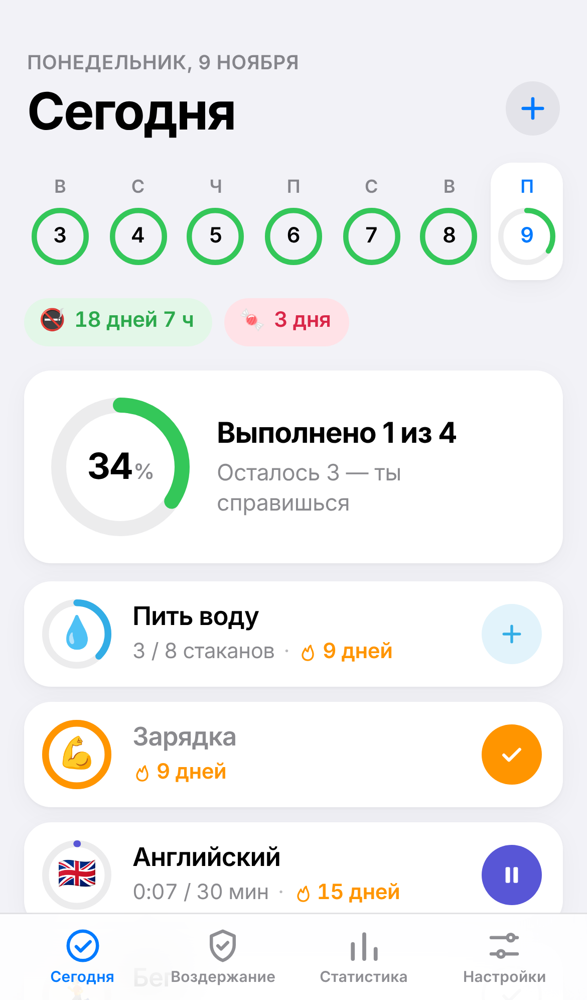
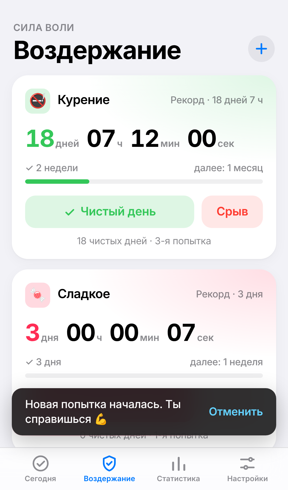
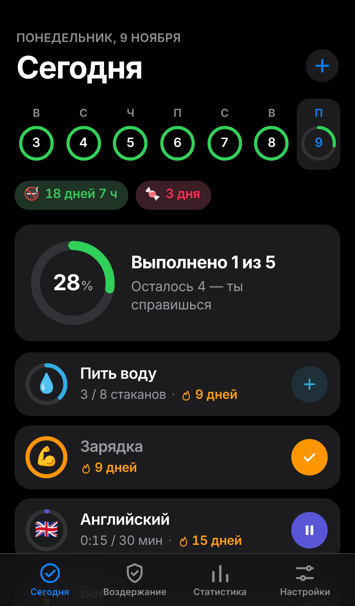

# My Habits

Личный трекер привычек и воздержания от вредных привычек в виде **Telegram Mini App**. Данные хранятся в твоём **приватном** GitHub-репозитории, запись идёт через твой сервер на Cloudflare. На телефоне нет ни одного ключа: вход подтверждается твоим аккаунтом Telegram. Напоминания приходят сообщением от бота.

<p>
  
  
  
</p>

## Что умеет

**Полезные привычки**
- Три типа: **галочка**, **количество с целью** (8 стаканов, 20 страниц) и **таймер** (30 минут английского).
- Расписание: каждый день, по дням недели или N раз в неделю.
- Кольца прогресса, полоса последних 7 дней, отметки задним числом (нажми на дату в заголовке).

**Детокс**
- Живой таймер «без срыва»: дни, часы, минуты, секунды.
- Ежедневная отметка «чистый день» и календарь чистых дней.
- Кнопка «Срыв»: таймер начинает новую попытку, а рекорд, история попыток и чистые дни сохраняются. Можно записать, что спровоцировало срыв.
- Вехи: 1 день → 3 дня → неделя → … → 2 года.

**Этапы и напоминания**
- Привычку можно разбить на этапы. Например, «Намаз»: Фаджр, Зухр, Аср, Магриб, Иша. Или «Вода»: после пробуждения 1–2, завтрак 1, обед 1, вечер 1–2.
- Время этапа задаётся точно (13:00), относительно подъёма или сна («через 10 мин после подъёма», «за 1,5 ч до сна») или по времени намаза.
- Время намаза считается автоматически по городу (по умолчанию метод Узбекистана, Аср по ханафитскому мазхабу), каждый намаз можно поправить на ±N минут.
- **Каза.** Если намаз отмечается после окончания его времени, приложение спрашивает: «Каза — восполняю» или «Читал вовремя, просто не отметил». Неотмеченные вовремя намазы становятся долгом каза, его можно восполнить в любой день. Каза засчитывается в серию, но в статистике показывается оранжевым.
- **Старые долги каза.** Калькулятор по годам и месяцам (лунный год), ручная правка по каждому намазу, цель «N в день» и прогноз даты завершения.
- **Джума.** По пятницам этап Зухра становится «Джума» (по умолчанию 13:00, напоминание за 45 минут). При отметке выбираешь: Джума или Зухр, если не успел.
- **Витр** — шестой этап после Иши, действует до Фаджра, напоминание приходит вместе с Ишей.
- Напоминания от бота: не приходят, если этап уже отмечен; повтор через N минут (для намаза — за 25 минут до конца его времени); тихие часы; вечерний чек-ин.

**Статистика**
- Текущие серии и рекорды, процент выполнения за 7 и 30 дней, график за 14 дней.
- Тепловая карта года, общая и по каждой привычке.
- Время нажатий: в какие часы ты обычно выполняешь привычку, медианное время каждого этапа, процент «вовремя».
- Достижения.

**Прочее**
- Дизайн в стиле iOS, светлая и тёмная тема (по системе или вручную).
- Экспорт и импорт данных в JSON.

## Как это устроено

```
Telegram ── Mini App (GitHub Pages) ──► Cloudflare Worker ──► my-habits-data (приватный репозиторий)
                 ▲                             │
                 └──── напоминания от бота ◄───┘  (cron раз в минуту)
```

## Настройка

1. **GitHub Pages:** открой Settings → Pages → Source: **GitHub Actions**.
2. **Приватный репозиторий** `my-habits-data`.
3. **Cloudflare:** зарегистрируйся, создай API-токен по шаблону **Edit Cloudflare Workers** и скопируй Account ID.
4. **Токен GitHub для сервера:** fine-grained токен только на `my-habits-data`, **Contents: Read and write**.
5. **Бот:** в Telegram открой @BotFather → `/newbot` → придумай имя и username → скопируй токен.
6. **Фраза-ключ:** придумай длинную фразу, она нужна один раз для привязки трекера к твоему Telegram.
7. **Секреты репозитория** (Settings → Secrets and variables → Actions):

   | Имя | Значение |
   |---|---|
   | `CLOUDFLARE_API_TOKEN` | токен Cloudflare |
   | `CLOUDFLARE_ACCOUNT_ID` | Account ID |
   | `DATA_TOKEN` | токен GitHub из шага 4 |
   | `TELEGRAM_BOT_TOKEN` | токен бота |
   | `PUSH_KEY` | фраза-ключ |

8. **Деплой:** открой Actions → **Deploy worker and Telegram bot** → Run workflow. Workflow развернёт сервер, подключит вебхук и кнопку «Трекер» в меню бота.
9. **Первый запуск:** открой бота → **Start** → **Трекер** → введи фразу-ключ один раз.

Если у тебя свой форк, поменяй адрес сервера в `js/config.js`.

## Кибла
Кнопка с компасом на «Сегодня» (рядом с зикрами) и строка «Кибла» в «Профиле → Намаз». Азимут и расстояние считаются по городу из Профиля (`js/qibla.js`, большой круг до Каабы 21.4225, 39.8262), отдельная геолокация не запрашивается.
- **Компас:** `WebApp.DeviceOrientation` в абсолютном режиме (Bot API 8.0), иначе браузерный датчик (`deviceorientationabsolute`, на iOS — `webkitCompassHeading` после разрешения). На Android Telegram даёт курс от магнитного севера (alpha = −азимут); поправка — магнитное склонение по встроенной модели **WMM2025** (NOAA, проверена по официальной контрольной точке). На iPhone курс от истинного севера, только если у Telegram есть доступ к геопозиции, — это отмечается переключателем на экране киблы (`settings.qibla.iosTrueNorth`).
- **Без компаса** (Desktop, нет датчика, отказ в доступе): азимут, расстояние и подсказка по солнцу (та же астрономия, что у времени намаза).
- Пока экран открыт, поворот экрана зафиксирован; при закрытии и сворачивании датчик останавливается.


Трекер можно открывать иконкой с экрана телефона (Telegram Bot API 8.0: `addToHomeScreen` / `checkHomeScreenStatus`). Строка «Иконка на экране «Домой»» — в «Профиле → Приложение»; на 3-й день использования на «Сегодня» появляется подсказка (✕ — больше не показывается, флаг `settings.homeScreen.hintDone` синхронизируется).

Один раз настрой **Main Mini App** у бота: @BotFather → `/mybots` → бот → **Bot Settings** → **Configure Mini App** → **Enable Mini App** → пришли адрес приложения (`https://<owner>.github.io/<repo>/`). Кнопка меню «Трекер» при этом остаётся.
- **Android:** системный диалог, Telegram сообщает, добавлена ли иконка. С Main Mini App иконка открывает трекер на весь экран (без него — через кнопку меню).
- **iPhone:** «Добавить» открывает Safari, дальше «Поделиться» → «На экран „Домой“». Telegram не сообщает, добавлена ли иконка. Без Main Mini App ярлык трекер не откроет.
- **Telegram Desktop и Web:** не поддерживается, строки нет.


- Сервер принимает запросы только с подписью Telegram (проверка `initData`) и только от аккаунта, который привязан фразой-ключом. Остальным он отвечает отказом.
- Токены GitHub и бота хранятся только в зашифрованных секретах Cloudflare и GitHub.
- Вне Telegram сайт показывает только заглушку и удаляет со старого устройства токен прежней версии.

## Как работает синхронизация
Приложение всегда работает с локальной копией. После каждого изменения (с задержкой ~1,5 с) и при открытии оно отправляет данные серверу. Сервер сливает их с `data.json` в репозитории, записывает результат и возвращает его обратно. Слияние идёт по времени изменения: для каждой отметки и каждой привычки побеждает более свежая правка, поэтому можно пользоваться с нескольких устройств, в том числе офлайн.

## Бэкап, версия данных и лимиты
- **Бэкап:** каждое воскресенье в 21:00 по местному времени бот присылает `data.json` документом (в подписи дата и число событий); отключается переключателем «Еженедельный бэкап в бота» в «Профиле → Данные». В любой момент можно прислать бэкап кнопкой. Время последнего бэкапа (в бота, еженедельного, экспорта) хранится в `data.backupLog` и видно на всех устройствах.
- **Сверка времени намаза:** «Профиль → Время намаза → Сверка с расписанием». Вводишь время с muslim.uz или из расписания мечети на одну или несколько дат, приложение показывает разницу и записывает средние поправки ±N. Если разница между датами больше 2 минут, появится предупреждение о сезонной зависимости. Поправки действуют везде: в напоминаниях бота и в отметках «вовремя / каза».
- **Сила привычки (ибадат):** у привычек с флагом «Ибадат» (намазы включаются автоматически, остальные — в редакторе) главная метрика — сила от 0 до 100. Она считается экспоненциальным сглаживанием по дням расписания, как в Loop Habit Tracker: при ежедневном выполнении около 80 через месяц и около 96 через два. Один пропуск снижает силу, но не обнуляет её; каза засчитывается вполовину. Пропуски подписываются мягко: «не отмечено».
- **Хиджрийский календарь:** под датой на «Сегодня» — дата по Умм аль-Кура, после Магриба — пометка «вечер N-го». Сдвиги месяцев по объявлению УМУ — «Профиль → Хиджрийский календарь». У привычки можно задать хиджрийское расписание: числа месяца (например, 13–15), дату, диапазон или весь месяц.
- **Каза:** Витр — отдельный долг (ваджиб). В запретное время (после восхода, перед Зухром, перед Магрибом; минуты в настройках) приложение подсказывает отложить восполнение. По желанию — порядок восполнения (тартиб): пока долгов меньше 6, при отметке намаза приложение подскажет сначала восполнить самый ранний.
- **Профиль:** последняя вкладка. Сверху — имя, @username и фото из Telegram (не сохраняются), «Моя ниййа» (до 300 символов, синхронизируется), личные параметры: город, часовой пояс («Автоматически (по городу)» или вручную), мазхаб (расчёт Асра). Ниже — разделы: Намаз (время, Джума, каза, хиджра), Распорядок (режим дня, напоминания), Приложение (оформление, архив, данные). Бот считает напоминания по поясу из профиля.
- **Удалить все данные:** «Профиль → Данные». Удаляет привычки, воздержания, всю историю, зикры, заметки и ниййю на всех устройствах и в репозитории (метка `resetAt`: при слиянии события старше неё отбрасываются). Настройки и остаток старого долга каза остаются. Импорт бэкапа после этого возвращает всё.
- **Сбросить прогресс:** «Профиль → Данные → Опасная зона». Стирает отметки, зикры, заметки, достижения, восполнения каза, попытки и чистые дни детоксов; привычки, детоксы (отсчёт — с момента сброса), архив, настройки и ниййа остаются. Тот же `resetAt`; детоксы получают `pAt`/`pDay`, и правка с устройства, не знающего о сбросе, обрезается до него. Долг каза на момент сброса переносится в остаток числом, пропуски по трекеру считаются со следующего дня; дни до сброса в статистике — «нет данных».
- **Опасные действия** (сброс, удаление, импорт): без защиты «Детокса» — ввод слова (СБРОС / УДАЛИТЬ), с защитой — код или Face ID. Перед действием бэкап уходит в бота с подписью «Перед сбросом прогресса / удалением / импортом»; если не ушёл — только «Скачать экспорт и продолжить» или «Отмена». Импорт сначала показывает превью файла. Пока идёт бэкап, открыта шторка ожидания (второе действие не запускается, запрос ограничен 30 с); после экспорта приложение спрашивает, сохранился ли файл. Импорт после сброса не меняет здешние настройки (тема, город, защита) — из файла берутся только долг каза и стёртая ниййа.
- **Достижения:** «Профиль → Достижения», видны только тебе (без публичности, «поделиться» и сообщений бота). Каталог — конфиг в `js/achievements.js` (5 достижений × 3 уровня): 5 фардов вовремя подряд (вовремя или «позже»), Джума подряд, восполнено каза всего, серия по любой привычке (неделя = 7 дней), дней без срыва. Считаются из существующих отметок и выдаются задним числом с фактической датой; полученное хранится в `data.achievements` и не пропадает (архивация, правка истории, синхронизация — объединение по id, самая ранняя дата). Пока «Детокс» закрыто, его достижения не видны и не считаются.
- **Защита «Детокса»:** «Профиль → Конфиденциальность». Код из 4 цифр хранится только на сервере (Durable Object `LockStore` — строго согласованное хранилище, сброс виден сразу; PBKDF2 с солью и «перцем» из токена бота), на iPhone раздел можно открывать по Face ID / Touch ID (Telegram BiometricManager), на других устройствах — только код. После 5 неверных кодов — пауза 30 с, затем 1, 5, 15 мин (счётчик на сервере). «Забыл код» — бот присылает кнопку «Сбросить код» (одноразовая, 15 минут), данные не удаляются. Пока раздел закрыт, его нет на «Сегодня», в «Статистике» и в чек-ине; бот пишет чек-ин без названий и не присылает еженедельный бэкап; экспорт и бэкап просят код. Раздел снова закрывается при уходе с вкладки (сразу, через 1 или 5 минут) и всегда — при закрытии мини-аппа. Защита на уровне интерфейса: данные в репозитории не шифруются.
- **Слияние настроек:** по полям, а не целиком. У каждого поля метка времени в `settings._t`; при синхронизации по каждому полю побеждает более свежее изменение (город с координатами и часовой пояс с режимом «по городу» — одной группой; эталоны сверки, сдвиги хиджры и избранные зикры — целиком). Метки ставятся автоматически при любом изменении настроек. Старые данные без меток получают метку `updatedAt`. Сервер урезает метки «из будущего» (часы телефона спешат) до своего времени. Код — `js/settings-merge.js`.
- **Тесты:** `node tests/run.mjs`. Запускаются в GitHub Actions перед каждым деплоем; если тесты падают, деплой не идёт.
- **Зикры:** кнопка 📿 на «Сегодня» → разделы (Все зикры, Избранное, позже — утренние и вечерние азкары) → список → счётчик. В счётчике нажатие в любом месте нижней части — +1; на цели (33/100) — галочка и вибрация, затем новый круг с 1. Между зикрами списка — свайп по тексту. Кнопки «Готово» нет: подход пишется в журнал (`logs.__dhikr`) сам — при смене зикра, выходе и сворачивании; если Telegram закрыли посреди счёта, подход сохранится при следующем открытии. Будущие азкары — тот же формат, что `data/dhikr.json`, плюс `count` (сколько раз читать).
- **Версия схемы:** в `data.json` есть поле `schemaVersion`. `js/migrate.js` по шагам приводит данные любой версии к актуальной, и в приложении, и на сервере. Неизвестные поля, разделы и виды отметок (`k`) из более новых версий сохраняются при слиянии.
- **Cloudflare KV** (бесплатный лимит 1000 записей в сутки): cron пишет в KV только когда реально отправил напоминание. В обычный день это около 30 записей. Ошибки KV и Telegram не останавливают рассылку. При 800 записях за сутки бот пришлёт предупреждение.

## Тесты
`node tests/run.mjs` — без зависимостей (Node 20+): миграции и слияние, API и бот, расход KV и ошибки, бэкап.

Автотест экранов `tests/e2e/screens.mjs` (Playwright, iPhone, светлая и тёмная тема): все вкладки, достижения, зикры и экран блокировки — без ошибок JS, без горизонтальной прокрутки, кнопки нажимаются в зоне 44×44. Запускается на каждый PR (workflow «Checks»), снимки экранов — артефакт `screens` у прогона. Локально:
`npm i --no-save playwright && npx playwright install chromium && node tests/e2e/screens.mjs` (снимки — в `tests/e2e/out`).

## Структура
```
index.html            оболочка и нижняя панель вкладок
css/tokens.css        токены iOS 27 из Figma: цвета (светлая/тёмная), шрифты, отступы, радиусы
css/styles.css        стили; цвета и размеры только через var(--…) из tokens.css
js/app.js             экраны и обработчики
js/logic.js           расписания, серии, проценты, вехи, достижения
js/store.js           данные, localStorage, слияние версий
js/migrate.js         версия схемы data.json и миграции
js/calibrate.js       сверка времени намаза с расписанием
js/hijri.js           хиджрийский календарь (Умм аль-Кура, сдвиги УМУ, Магриб)
js/dhikr.js           счётчик зикров: подходы, восстановление, итоги
data/dhikr.json       тексты зикров
js/sync.js            синхронизация с сервером
js/ui.js              кольца, тепловая карта, графики, шторки
js/util.js            даты и форматирование
js/prayer.js          расчёт времени намаза
js/schedule.js        этапы, напоминания, статистика по времени
js/tg.js              интеграция с Telegram Mini App
js/config.js          адрес сервера
worker/               Cloudflare Worker: API, бот, напоминания
sw.js                 офлайн-кэш
tests/                тесты (node tests/run.mjs)
```
Без сборки и зависимостей: чистые HTML, CSS и JS-модули.
