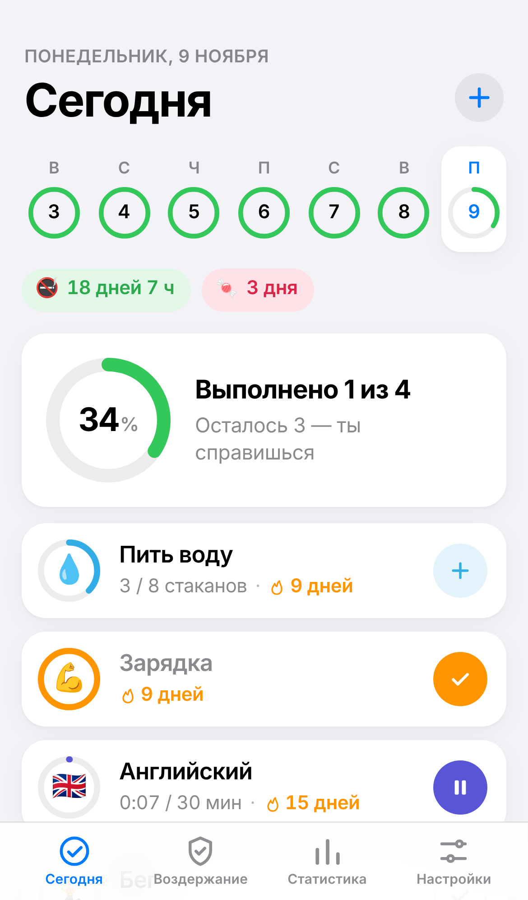
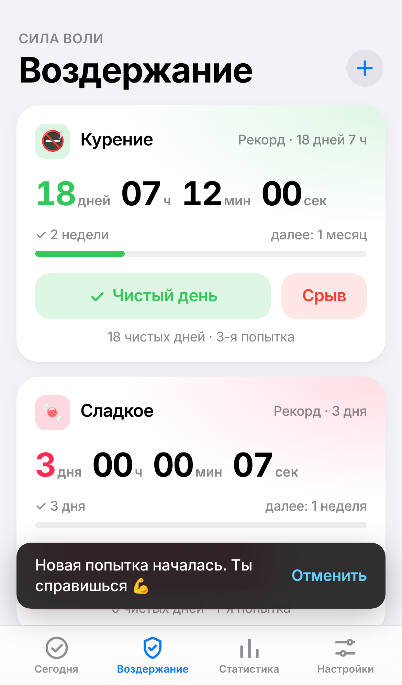
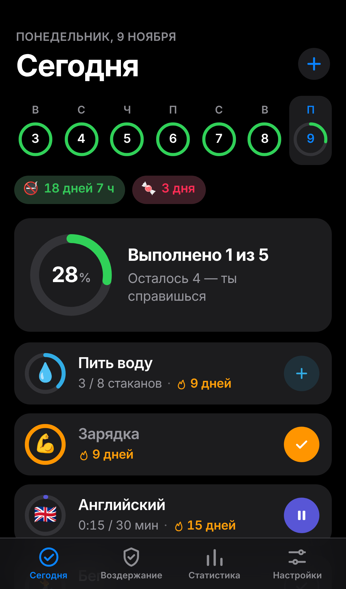

# My Habits

Личный трекер привычек и воздержания от вредных привычек в виде **Telegram Mini App**. Данные хранятся в твоём **приватном** GitHub-репозитории, запись идёт через твой сервер на Cloudflare. На телефоне нет ни одного ключа: вход подтверждается твоим аккаунтом Telegram. Напоминания приходят сообщением от бота.

<p>
  
  
  
</p>

## Что умеет

**Полезные привычки**
- Три типа: **галочка**, **количество с целью** (8 стаканов, 20 страниц) и **таймер** (30 минут английского).
- Расписание: каждый день, по дням недели или N раз в неделю.
- Кольца прогресса, полоса последних 7 дней, отметки задним числом (нажми на дату в заголовке).

**Воздержание**
- Живой таймер «без срыва»: дни, часы, минуты, секунды.
- Ежедневная отметка «чистый день» и календарь чистых дней.
- Кнопка «Срыв»: таймер начинает новую попытку, а рекорд, история попыток и чистые дни сохраняются. Можно записать, что спровоцировало срыв.
- Вехи: 1 день → 3 дня → неделя → … → 2 года.

**Этапы и напоминания**
- Привычку можно разбить на этапы. Например, «Намаз»: Фаджр, Зухр, Аср, Магриб, Иша. Или «Вода»: после пробуждения 1–2, завтрак 1, обед 1, вечер 1–2.
- Время этапа задаётся точно (13:00), относительно подъёма или сна («через 10 мин после подъёма», «за 1,5 ч до сна») или по времени намаза.
- Время намаза считается автоматически по городу (по умолчанию метод Узбекистана, Аср по ханафитскому мазхабу), каждый намаз можно поправить на ±N минут.
- **Каза.** Если намаз отмечается после окончания его времени, приложение спрашивает: «Каза — восполняю» или «Читал вовремя, просто не отметил». Неотмеченные вовремя намазы становятся долгом каза, его можно восполнить в любой день. Каза засчитывается в серию, но в статистике показывается оранжевым.
- **Старые долги каза.** Калькулятор по годам и месяцам (лунный год), ручная правка по каждому намазу, цель «N в день» и прогноз даты завершения.
- **Джума.** По пятницам этап Зухра становится «Джума» (по умолчанию 13:00, напоминание за 45 минут). При отметке выбираешь: Джума или Зухр, если не успел.
- **Витр** — шестой этап после Иши, действует до Фаджра, напоминание приходит вместе с Ишей.
- Напоминания от бота: не приходят, если этап уже отмечен; повтор через N минут (для намаза — за 25 минут до конца его времени); тихие часы; вечерний чек-ин.

**Статистика**
- Текущие серии и рекорды, процент выполнения за 7 и 30 дней, график за 14 дней.
- Тепловая карта года, общая и по каждой привычке.
- Время нажатий: в какие часы ты обычно выполняешь привычку, медианное время каждого этапа, процент «вовремя».
- Достижения.

**Прочее**
- Дизайн в стиле iOS, светлая и тёмная тема (по системе или вручную).
- Экспорт и импорт данных в JSON.

## Как это устроено

```
Telegram ── Mini App (GitHub Pages) ──► Cloudflare Worker ──► my-habits-data (приватный репозиторий)
                 ▲                             │
                 └──── напоминания от бота ◄───┘  (cron раз в минуту)
```

## Настройка

1. **GitHub Pages:** открой Settings → Pages → Source: **GitHub Actions**.
2. **Приватный репозиторий** `my-habits-data`.
3. **Cloudflare:** зарегистрируйся, создай API-токен по шаблону **Edit Cloudflare Workers** и скопируй Account ID.
4. **Токен GitHub для сервера:** fine-grained токен только на `my-habits-data`, **Contents: Read and write**.
5. **Бот:** в Telegram открой @BotFather → `/newbot` → придумай имя и username → скопируй токен.
6. **Фраза-ключ:** придумай длинную фразу, она нужна один раз для привязки трекера к твоему Telegram.
7. **Секреты репозитория** (Settings → Secrets and variables → Actions):

   | Имя | Значение |
   |---|---|
   | `CLOUDFLARE_API_TOKEN` | токен Cloudflare |
   | `CLOUDFLARE_ACCOUNT_ID` | Account ID |
   | `DATA_TOKEN` | токен GitHub из шага 4 |
   | `TELEGRAM_BOT_TOKEN` | токен бота |
   | `PUSH_KEY` | фраза-ключ |

8. **Деплой:** открой Actions → **Deploy worker and Telegram bot** → Run workflow. Workflow развернёт сервер, подключит вебхук и кнопку «Трекер» в меню бота.
9. **Первый запуск:** открой бота → **Start** → **Трекер** → введи фразу-ключ один раз.

Если у тебя свой форк, поменяй адрес сервера в `js/config.js`.

## Безопасность
- Сервер принимает запросы только с подписью Telegram (проверка `initData`) и только от аккаунта, который привязан фразой-ключом. Остальным он отвечает отказом.
- Токены GitHub и бота хранятся только в зашифрованных секретах Cloudflare и GitHub.
- Вне Telegram сайт показывает только заглушку и удаляет со старого устройства токен прежней версии.

## Как работает синхронизация
Приложение всегда работает с локальной копией. После каждого изменения (с задержкой ~1,5 с) и при открытии оно отправляет данные серверу. Сервер сливает их с `data.json` в репозитории, записывает результат и возвращает его обратно. Слияние идёт по времени изменения: для каждой отметки и каждой привычки побеждает более свежая правка, поэтому можно пользоваться с нескольких устройств, в том числе офлайн.

## Бэкап, версия данных и лимиты
- **Бэкап:** каждое воскресенье в 21:00 по местному времени бот присылает `data.json` документом (в подписи дата и число событий). В любой момент можно прислать бэкап кнопкой в «Настройках → Резервная копия».
- **Сверка времени намаза:** «Настройки → Время намаза → Сверка с расписанием». Вводишь время с muslim.uz или из расписания мечети на одну или несколько дат, приложение показывает разницу и записывает средние поправки ±N. Если разница между датами больше 2 минут, появится предупреждение о сезонной зависимости. Поправки действуют везде: в напоминаниях бота и в отметках «вовремя / каза».
- **Сила привычки (ибадат):** у привычек с флагом «Ибадат» (намазы включаются автоматически, остальные — в редакторе) главная метрика — сила от 0 до 100. Она считается экспоненциальным сглаживанием по дням расписания, как в Loop Habit Tracker: при ежедневном выполнении около 80 через месяц и около 96 через два. Один пропуск снижает силу, но не обнуляет её; каза засчитывается вполовину. Пропуски подписываются мягко: «не отмечено».
- **Версия схемы:** в `data.json` есть поле `schemaVersion`. `js/migrate.js` по шагам приводит данные любой версии к актуальной, и в приложении, и на сервере. Неизвестные поля, разделы и виды отметок (`k`) из более новых версий сохраняются при слиянии.
- **Cloudflare KV** (бесплатный лимит 1000 записей в сутки): cron пишет в KV только когда реально отправил напоминание. В обычный день это около 30 записей. Ошибки KV и Telegram не останавливают рассылку. При 800 записях за сутки бот пришлёт предупреждение.

## Тесты
`node tests/run.mjs` — без зависимостей (Node 20+): миграции и слияние, API и бот, расход KV и ошибки, бэкап.

## Структура
```
index.html            оболочка и нижняя панель вкладок
css/styles.css        стили (iOS-токены, светлая и тёмная тема)
js/app.js             экраны и обработчики
js/logic.js           расписания, серии, проценты, вехи, достижения
js/store.js           данные, localStorage, слияние версий
js/migrate.js         версия схемы data.json и миграции
js/calibrate.js       сверка времени намаза с расписанием
js/sync.js            синхронизация с сервером
js/ui.js              кольца, тепловая карта, графики, шторки
js/util.js            даты и форматирование
js/prayer.js          расчёт времени намаза
js/schedule.js        этапы, напоминания, статистика по времени
js/tg.js              интеграция с Telegram Mini App
js/config.js          адрес сервера
worker/               Cloudflare Worker: API, бот, напоминания
sw.js                 офлайн-кэш
tests/                тесты (node tests/run.mjs)
```
Без сборки и зависимостей: чистые HTML, CSS и JS-модули.
